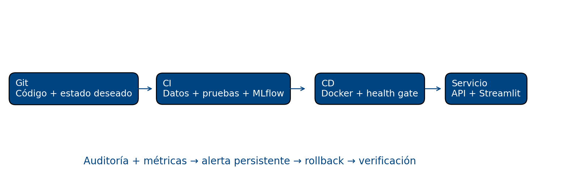
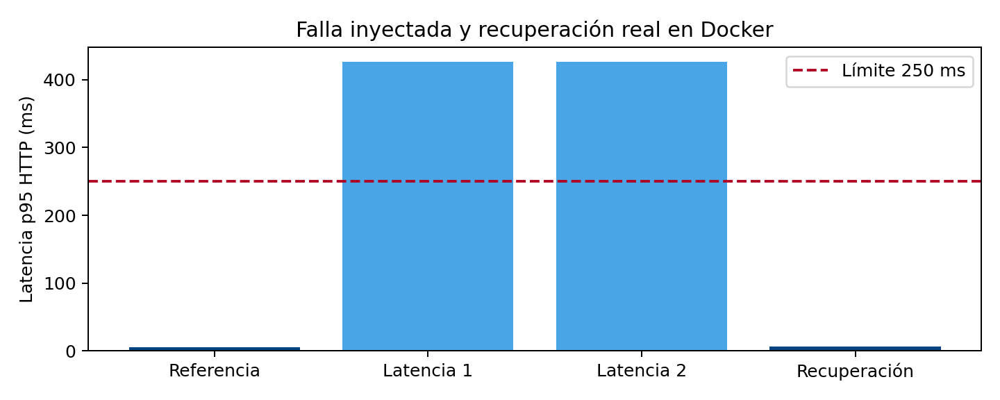
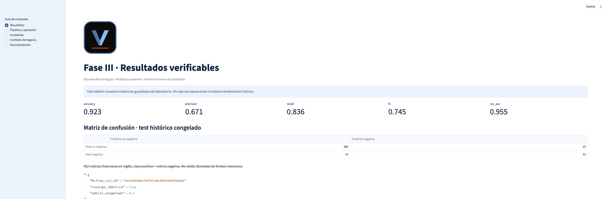

<p align="center"></p>

# Fase III · Resultados

**Eduardo Aburto Angulo · Gestión de proyectos de inteligencia artificial**

Asistente de preparación de revisiones de portafolio. Esta fase convierte el modelo de las entregas anteriores en un servicio con validación, seguimiento de experimentos y despliegue reproducible. Como banquero Sr., mi criterio es priorizar una revisión útil para el cliente, preservar su perfil y mantener trazabilidad de cada decisión.

> **Entrega académica con ejecución comprobada.** El pipeline de GitHub superó validación y despliegue temporal. No se habilitan órdenes de inversión ni se afirma disponibilidad de producción.

[](https://github.com/eduardoaburtoa/fase3-mlops-gitops-portafolios/actions/workflows/pipeline.yml)

## Guía de contenido

| Contenido | Acceso |
|---|---|
| **Documentos y versiones editables** | [PDF, Word y Google Docs](documentos/README.md) |
| **Pipeline explicativo** | [Leer](documentos/01_Pipeline.md) · [PDF](documentos/01_Pipeline.pdf) |
| **Operación del servicio** | [Leer](documentos/02_Operacion.md) · [PDF](documentos/02_Operacion.pdf) |
| **Portfolio técnico estratégico** | [Leer](documentos/03_Portfolio.md) · [PDF](documentos/03_Portfolio.pdf) |
| **Entrevista profesional** | [Video MP4 de 5 minutos](video/Entrevista_FaseIII.mp4) · [Guion](video/Guion_entrevista.md) |
| **Evidencias y capturas** | [Índice verificable](evidencias/README.md) |
| Automatización de integración y despliegue | [Pipeline](.github/workflows/pipeline.yml) |
| API e integración | [Backend](backend/main.py) |
| Estado deseado del entorno de prueba | [Configuración GitOps](deploy/staging.json) |
| Despliegue y rollback | [Reconciliador](scripts/reconcile.py) |
| Simulación de incidentes | [Experimento reproducible](scripts/run_demo.py) |
| Monitoreo y presupuestos de error | [Monitor](scripts/monitor.py) · [SLO](config/slo.json) |
| Validación y MLflow | [Evaluación](scripts/evaluate.py) · [Resultados](evidencias/evaluacion.json) |
| Pruebas automatizadas | [Pruebas](pruebas/test_pipeline.py) |
| Tablero Streamlit | [Aplicación](app.py) |
| Continuidad y procedencia | [Registro de fuentes](evidencias/procedencia.json) |

## Resultados del modelo congelado

Reevaluación de 452 noticias financieras en inglés: accuracy **0.9226**, precision **0.6711**, recall **0.8361**, F1 **0.7445**, ROC-AUC **0.9548**. Umbral preservado: **0.20**. Matriz de confusión: TN 366, FP 25, FN 10, TP 51. La recarga desde MLflow produjo predicciones idénticas. Estos resultados no demuestran rentabilidad de fondos mexicanos ni sustituyen una validación de dominio.

## Reproducción

Python 3.12 y Docker. Desde la raíz del repositorio:

```bash
python -m venv .venv
source .venv/bin/activate
pip install -r requirements.txt
python -m pytest pruebas -q
python scripts/evaluate.py
docker build -t vertice-fase3:local .
export API_TOKEN=$(openssl rand -hex 32)
python scripts/run_demo.py --image vertice-fase3:local
streamlit run app.py
```

El servicio se publica únicamente en `127.0.0.1:18083`. Los experimentos MLflow quedan en `runtime/mlruns`; puede abrirse el panel con `mlflow ui --backend-store-uri runtime/mlruns`. El pipeline de GitHub despliega en un ejecutor temporal: es una demostración funcional de CD, no un alojamiento permanente.

## Contexto y límites

Los 150 clientes con personalidad de superhéroes y villanos son ficticios, con posiciones de 5 a 20 millones de pesos. El corretaje de 1 % por compra y 1 % por venta es un supuesto académico, no una tarifa verificada de BBVA. La aplicación exige compatibilidad de perfil y beneficio incremental positivo después de costos para considerar una revisión. No garantiza rendimientos ni ejecuta migraciones.

## Antecedentes

[Actividad 4](https://github.com/eduardoaburtoa/motor-senales-nlp) · [Actividad 5](https://github.com/eduardoaburtoa/actividad5-mlflow-portafolios) · [Actividad 6](https://github.com/eduardoaburtoa/actividad6-evaluacion-portafolios) · [Fase II](https://github.com/eduardoaburtoa/fase2-despliegue-portafolios) · [Actividad 8](https://github.com/eduardoaburtoa/actividad8-observabilidad-portafolios) · [Actividad 9](https://github.com/eduardoaburtoa/actividad9-escalabilidad-gobernanza)

## Arquitectura y resultados operativos



El despliegue local comprobó la recuperación de un contenedor detenido, el rechazo de un candidato no listo y el rollback de una configuración lenta. El p95 de latencia se recuperó de aproximadamente 426 ms a 6.6 ms. La corrida completa excedió el presupuesto de latencia por los incidentes deliberados.



## Tablero Streamlit

Cinco vistas: resultados, pipeline, incidentes, contexto y documentación. Muestra evidencias guardadas; no es monitoreo en vivo de una cuenta bancaria.



## Cobertura de la rúbrica

[Revisión criterio por criterio](VALIDACION_RUBRICA.md)

| Criterio | Evidencia principal |
|---|---|
| Pipeline automatizado | CI, CD, pruebas, hashes y exportación MLflow |
| Operación técnica | SLO, auditoría, incidentes y rollback ejecutado |
| Portfolio profesional | Problema, valor esperado, decisiones, resultados y límites |
| Presentación e entrevista | MP4 de 5 minutos con ocho preguntas técnicas y de gestión |

La entrevista usa narración sintética y un guion dramatizado en primera persona. No reproduce la voz real del autor. [Bitácora y mejoras](CHANGELOG.md).
