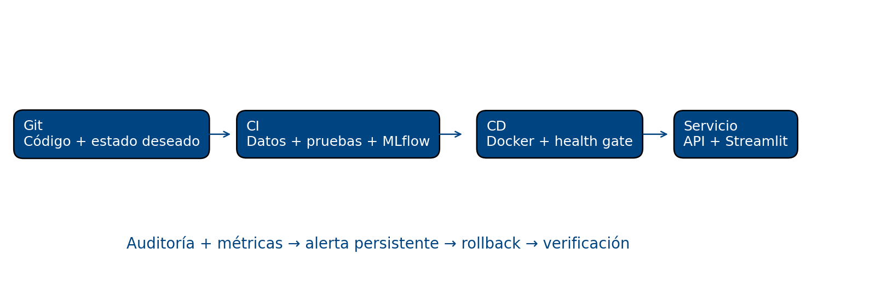
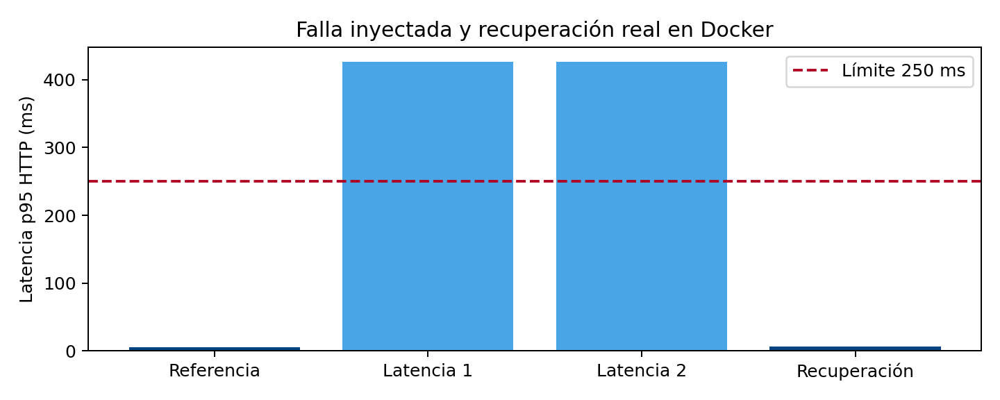

# Pipeline automatizado de inteligencia artificial

Eduardo Aburto Angulo · Fase III

## Decisión y alcance

Construí un flujo reproducible que valida el modelo congelado, registra la evaluación en MLflow y despliega una API mediante Docker. Mi decisión es demostrar el ciclo operativo en un entorno académico aislado antes de plantear una incorporación bancaria. La configuración mantiene production_authorized=false. El servicio no decide operaciones financieras.
La continuidad conserva el modelo de Actividad 6 y la API de Fase II. Actividades 8 y 9 aportan observabilidad, límites y gobierno. Las referencias exactas de código están en evidencias/procedencia.json. No volví a elegir el umbral con el test.

## Integración y versionamiento

Cada push a main ejecuta dos trabajos: validate y deploy-staging. Las solicitudes de cambio ejecutan validación sin despliegue. validate instala dependencias fijadas, comprueba contratos de datos y API, reevalúa el modelo y exporta los artefactos MLflow. deploy-staging depende del éxito de validate, construye una imagen etiquetada con el SHA del commit y ejecuta el reconciliador.
Git versiona código, configuración y manifiestos. SHA-256 fija los bytes del modelo, test y clientes ficticios. El modelo se verifica antes de deserializarlo. MLflow conserva parámetros, métricas, modelo y evaluación; su recarga se contrasta con predicciones idénticas. El paquete joblib sólo debe cargarse si procede de este origen confiable; el hash aporta integridad, no una firma de autoría.

## Despliegue y reconciliación

deploy/staging.json define nombre, puerto, límites y hash esperado. El reconciliador resuelve la imagen a un identificador inmutable, inicia el contenedor y verifica /health y /v1/model con autenticación. Una segunda reconciliación sin cambios no recrea el servicio. Si el contenedor desaparece, restaura el estado deseado.
El laboratorio usa un contenedor único y por tanto puede interrumpir brevemente el servicio durante el reemplazo. No acredita despliegue sin interrupciones ni alta disponibilidad. Si falla la verificación de salud, restaura la configuración anterior. El experimento de latencia revierte la configuración de la misma imagen; no simula una nueva versión entrenada. El ejecutor de GitHub es temporal y no constituye una URL pública permanente.

## Pruebas y evidencia

La ejecución local superó nueve pruebas automatizadas: integridad de datos, autenticación, contrato de inferencia y trace_id, cuatro entradas inválidas, escenario comercial, reglas SLO y salud no disponible. La evaluación usa 452 registros históricos sin ajustar el modelo. La recarga MLflow fue idéntica.
La prueba Docker confirmó despliegue inicial, reconciliación idempotente, recuperación de un contenedor detenido, rechazo de un candidato no listo y rollback después de dos ventanas lentas. El archivo despliegue.json conserva las observaciones; auditoria.jsonl conserva las decisiones. Las corridas de GitHub y sus artefactos permiten verificar la ejecución independiente. El resultado local no reemplaza la comprobación del estado de Actions.

## Reproducción y límites

Requisitos: Python 3.12, Docker y memoria suficiente para instalar dependencias. Ejecutar pip install -r requirements.txt; python -m pytest pruebas -q; python scripts/evaluate.py; docker build -t vertice-fase3:local .; definir API_TOKEN mediante un secreto aleatorio de al menos 16 caracteres; python scripts/run_demo.py --image vertice-fase3:local. Para el tablero: streamlit run app.py.
La API escucha en loopback 18083. El contenedor usa un usuario sin privilegios, dos CPU y 1 GB como límites de laboratorio. No se versionan secretos ni el directorio runtime. Para abrir MLflow: mlflow ui --backend-store-uri runtime/mlruns. Antes de producción exigiría validación del dominio, derechos de uso del dataset, revisión de seguridad, supervisión humana y un entorno persistente con gestión centralizada de secretos.
## Pruebas automatizadas de datos

La puerta de calidad empieza en `scripts/check_data.py`, antes de cargar el modelo para la reevaluación. Cada archivo del manifiesto se lee como bytes y se compara mediante SHA-256 con la referencia versionada. Un cambio de contenido, incluso si la estructura del CSV parece correcta, produce `ValueError` y una salida no exitosa. No actualizo el manifiesto para hacer pasar un archivo inesperado: primero debo identificar y justificar el cambio.

| Archivo controlado | SHA-256 esperado |
|---|---|
| Modelo SVM calibrada | f48c7496d5a12bd15d535721e3e83c6ef895b1ae7eaccbe7f4f4c60705bb1916 |
| Predicciones del test | ac1c67489c5f7c0eb9eefdc956829a5c791b5b7c62e9450282475cbcfaaa819b |
| Clientes simulados | 88f29f5781aed1465bf200763e144570103706e5ea2167ace5d1a738da35accf |

Una vez validada la integridad, el script comprueba reglas semánticas. Los identificadores del test deben ser únicos; `texto` e `y` no pueden estar vacíos; las clases observadas deben ser 0 y 1. Además, la etiqueta numérica debe coincidir con el significado de `negative`. Esto evita invertir la interpretación de la clase positiva sin advertirlo. El archivo de test conserva 452 filas y su tamaño también se verifica en la prueba automatizada.

| Conjunto | Regla | Consecuencia de fallo |
|---|---|---|
| Test | Identificador único y texto/objetivo presentes | Se detiene la validación; no se evalúa ni despliega |
| Test | Clases 0 y 1 y correspondencia con etiqueta negativa | Evita presentar métricas con etiquetas intercambiadas |
| Clientes | Exactamente 150 e identificadores únicos | Impide cambiar inadvertidamente el escenario didáctico |
| Clientes | Posiciones entre 5 y 20 millones MXN | Preserva el rango del caso de banquero Sr. |
| Clientes | Perfiles Conservador, Moderado o Agresivo | Rechaza categorías no contempladas por el contrato |

Las reglas de estructura se implementan mediante aserciones. La reproducción indicada ejecuta Python sin optimización; no debe usarse `python -O`, que deshabilita esas aserciones. Dejo visible esta limitación sin alterar la ingeniería aprobada en esta revisión documental. Los hashes prueban identidad del archivo, no exactitud económica de sus datos, ausencia de sesgo ni derechos de uso. Por eso el control técnico no sustituye la revisión del origen y del propósito.

## Pruebas de código y contrato de servicio

El archivo `pruebas/test_pipeline.py` reúne nueve casos ejecutados por pytest. La parametrización de entradas inválidas representa cuatro casos separados. La evidencia XML y las corridas de Actions permiten comprobar qué pasó, en lugar de asumir que tener un archivo de pruebas equivale a ejecutarlo.

| Caso o grupo | Cantidad | Qué verifica |
|---|---:|---|
| Datos y test de referencia | 1 | Reglas de integridad y 452 registros |
| Autenticación e inferencia | 1 | Rechazo sin credencial, respuesta válida, trace_id y métricas |
| Entradas inválidas parametrizadas | 4 | Texto corto, idioma no admitido, campo extra y longitud excesiva |
| Escenario financiero | 1 | Costos mayores que mejora supuesta y rechazo de NaN |
| Monitor SLO | 1 | Muestra insuficiente, ventana sana, latencia y errores |
| Salud no disponible | 1 | Respuesta 503 al inyectar fallo de disponibilidad del candidato |

Estas pruebas no cubren toda amenaza posible. No son una auditoría de penetración, una prueba de carga sostenida ni una validación de idoneidad financiera. Su contribución es detectar regresiones de los contratos implementados. En negocio, una salida técnicamente válida pero interpretada como orden de inversión seguiría siendo un uso incorrecto; el aviso y la supervisión humana forman parte del alcance.

## Versionado de modelos y artefactos

Distingo cuatro identidades: revisión de código, contenido del modelo, ejecución de evaluación e imagen del servicio. Git conserva scripts, configuración y manifiestos. El hash SHA-256 identifica los bytes exactos del modelo. MLflow asigna un `run_id` y registra parámetros, métricas, modelo y archivo de evaluación. Docker identifica la imagen construida; la automatización la etiqueta con el commit y el reconciliador obtiene su identificador inmutable.

| Elemento | Identificador o ubicación | Qué recupera |
|---|---|---|
| Código y estado deseado | Commit Git y `deploy/staging.json` | Decisiones y configuración de una revisión |
| Modelo | `modelos/manifest.json` y SHA-256 | Artefacto exacto congelado |
| Evaluación local final original | e42cb64dee744747a0c6916a59fad64a | Métricas y artefacto MLflow de esa corrida |
| Imagen | Identificador registrado en `despliegue.json` | Contenedor usado en el laboratorio |
| Estado previo | `runtime/deployment.json` | Configuración anterior disponible para rollback local |
| Evidencia CI | Artefactos de cada corrida de Actions | Resultado de validación y despliegue ligado al commit |

El registro como artefacto MLflow no debe confundirse con un catálogo de versiones promovidas en Model Registry: esa promoción no está implementada. Para recuperar una revisión de código utilizo el historial Git; para recuperar el modelo verifico los bytes del manifiesto; para revertir el servicio uso el estado anterior que conoce el reconciliador. Si el estado local se pierde, no afirmo que exista recuperación automática desde un repositorio remoto de imágenes. Esa capacidad sería una mejora futura.

## Secuencia de promoción y manejo del fallo

La automatización tiene dependencia explícita: `deploy-staging` necesita que `validate` termine correctamente. En un pull request se valida sin desplegar; en main se habilita el trabajo de despliegue. Las excepciones de datos, errores de pruebas o discrepancias en probabilidades bloquean el camino antes de construir una conclusión de éxito. Los artefactos del despliegue se conservan incluso si el trabajo falla, mediante la condición `always()`.

El reconciliador comprueba `production_authorized=false` y el entorno académico. Después verifica autenticación, salud y coincidencia del hash esperado. La clave se transmite al contenedor mediante variable de entorno, sin escribir su valor en la línea de argumentos del comando Docker. Las evidencias publicadas excluyen la credencial. Esto reduce exposición accidental; no equivale a disponer de un gestor central de secretos ni a resolver rotación y revocación industrial.

Figura 1. Flujo implementado de validación, despliegue y observación. El diagrama resume relaciones; Streamlit muestra evidencia guardada y no controla operaciones bancarias.

## Evidencias de ejecución y lectura correcta

La corrida 45922494111 aprobó la primera versión del pipeline. La corrida 45924738199 aprobó la revisión posterior: ambos trabajos terminaron en éxito. Las pruebas locales y la segunda ejecución Docker complementan esa evidencia. No agrego sus tiempos como si fueran un ensayo estadístico: los entornos y las condiciones no son iguales.

La primera invocación del experimento se hizo antes de que terminara de construirse la imagen y falló al buscarla. La bitácora conserva ese antecedente. Corregí la secuencia esperando la construcción; no oculté el fallo ni lo conté como un despliegue exitoso. De manera similar, se añadió una firma explícita al modelo registrado en MLflow después de una advertencia al inferirla desde una lista. El modelo predictivo no cambió.

Figura 2. Latencia del primer ensayo Docker: referencia, dos ventanas con retardo y recuperación. Fuente: `evidencias/despliegue.json`. El retorno a una ventana sana no restaura retroactivamente el presupuesto consumido.

## Continuidad técnica y criterio de cierre

Actividad 8 aportó el enfoque de observabilidad y respuesta estructurada; Actividad 9 aportó la lectura de costos y gobierno responsable. Fase III conserva esa intención con una implementación acotada: trazas locales, contadores en memoria y un contenedor. No afirmo que todas las funciones de las actividades previas estén desplegadas dentro de este servicio.

Mantengo el umbral 0.20 y el modelo en inglés. El corpus tiene licencia CC BY-NC-SA 3.0; el uso bancario comercial exige resolver derechos y validación de dominio. Los personajes ficticios, con posiciones de 5 a 20 millones MXN, no representan clientes reales. El 1 % de compra y el 1 % de venta son supuestos académicos. Las comisiones no justifican rotación innecesaria y una noticia negativa inicia análisis, no autoriza una operación. La IA no sustituye el criterio del banquero; lo aumenta.

## Evidencia del proceso y fundamentos

La [bitácora](../evidencias/bitacora.md) reconstruye decisiones a partir de commits y configuración. El [registro de versiones](../evidencias/registro_versiones.md) documenta la cadena de procedencia y el umbral elegido con desarrollo en Actividad 6. No hubo reentrenamiento en Fase III. Actividad 8 aporta el antecedente de observabilidad y Actividad 9 el de escalabilidad, FinOps y gobierno. La meta conjunta histórica de recall ≥90 % y precisión ≥60 % no se alcanzó; no la presento como cumplida.

Las decisiones de SLO y presupuesto se relacionan con Beyer et al. (2018); el seguimiento de artefactos con MLflow (s. f.); los contratos de servicio con Ramírez (s. f.); la portabilidad y automatización con Docker (s. f.) y GitHub (s. f.); y la evaluación con Scikit-learn developers (s. f.). Malo et al. (2014) documentan el problema de orientación semántica financiera del corpus. NIST (2023) e ISO/IEC 42001:2023 aportan referentes de gestión responsable; citarlos no equivale a certificar cumplimiento ni a acreditar una auditoría normativa integral. La rúbrica de Universidad Tecmilenio (2026) determina los cuatro entregables.

## Conclusiones

Concluyo que el pipeline deja una cadena verificable entre datos, código, modelo y despliegue académico. Como banquero Sr., me resulta más útil conocer qué validación precede a una señal que recibir una promesa de automatización sin límites. Mantengo el ánimo de convertir esta disciplina en una práctica de piloto, con derechos de datos resueltos y evidencia de dominio. No cambio el modelo ni el umbral para mejorar la apariencia del cierre. La IA no sustituye el criterio del banquero; lo aumenta.

## Referencias

Beyer, B., Murphy, N. R., Rensin, D. K., Kawahara, K., & Thorne, S. (Eds.). (2018). *The site reliability workbook: Practical ways to implement SRE*. O’Reilly Media. https://sre.google/workbook/table-of-contents/

Docker, Inc. (s. f.). *Docker documentation*. Recuperado el 27 de noviembre de 2026, de https://docs.docker.com/

GitHub. (s. f.). *GitHub Actions documentation*. Recuperado el 27 de noviembre de 2026, de https://docs.github.com/en/actions

International Organization for Standardization, & International Electrotechnical Commission. (2023). *Information technology—Artificial intelligence—Management system* (ISO/IEC Standard No. 42001:2023). https://www.iso.org/standard/42001

Malo, P., Sinha, A., Korhonen, P., Wallenius, J., & Takala, P. (2014). Good debt or bad debt: Detecting semantic orientations in economic texts. *Journal of the Association for Information Science and Technology, 65*(4), 782–796. https://doi.org/10.1002/asi.23062

MLflow. (s. f.). *MLflow tracking*. Recuperado el 27 de noviembre de 2026, de https://mlflow.org/docs/latest/ml/tracking/

National Institute of Standards and Technology. (2023). *Artificial intelligence risk management framework (AI RMF 1.0)* (NIST AI 100-1). https://doi.org/10.6028/NIST.AI.100-1

Ramírez, S. (s. f.). *FastAPI*. Recuperado el 27 de noviembre de 2026, de https://fastapi.tiangolo.com/

Scikit-learn developers. (s. f.). *Scikit-learn user guide*. Recuperado el 27 de noviembre de 2026, de https://scikit-learn.org/stable/user_guide.html

Universidad Tecmilenio. (2026). *Gestión de proyectos de inteligencia artificial: Proyecto Fase III Resultados y rúbrica de evaluación* [Material del curso, Módulo 3, Semana 12].

## Cobertura de la rúbrica

| Apartado | Cómo lo cubre esta entrega | Evidencia complementaria |
|---|---|---|
| Pipeline automatizado de IA | Validación de código y datos, versionado y CD temporal | 01_Pipeline.pdf, workflow y corridas Actions |
| Operación técnica | Métricas, auditoría, incidentes y optimización delimitada | 02_Operacion.pdf y archivos de evidencia |
| Portfolio técnico estratégico | Valor esperado, stack, trayectoria y resultados | 03_Portfolio.pdf y business case de Fase I |
| Entrevista profesional | Guion, MP4 existente y material de grabación personal | Video sintético identificado; grabación propia pendiente |

Este documento fue estructurado precisamente para cubrir esos 4 apartados de forma explícita y verificable.
