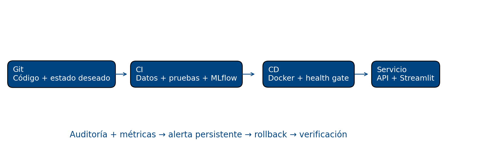
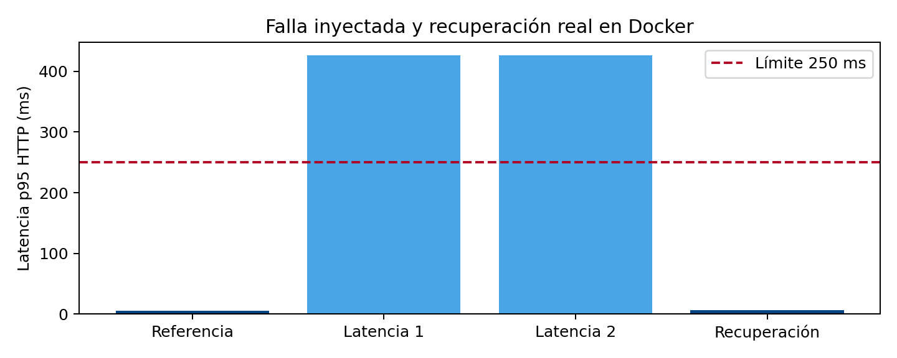
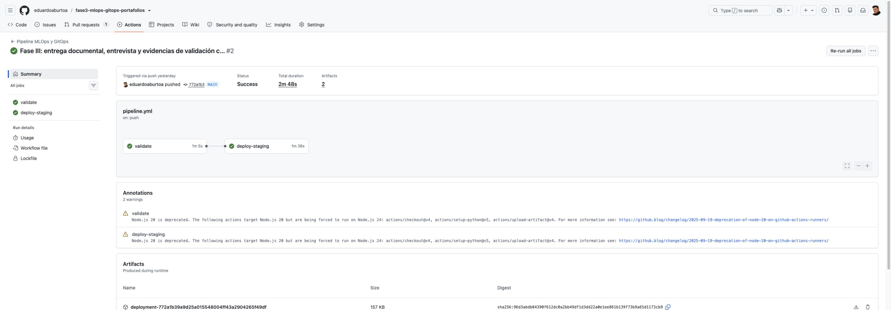
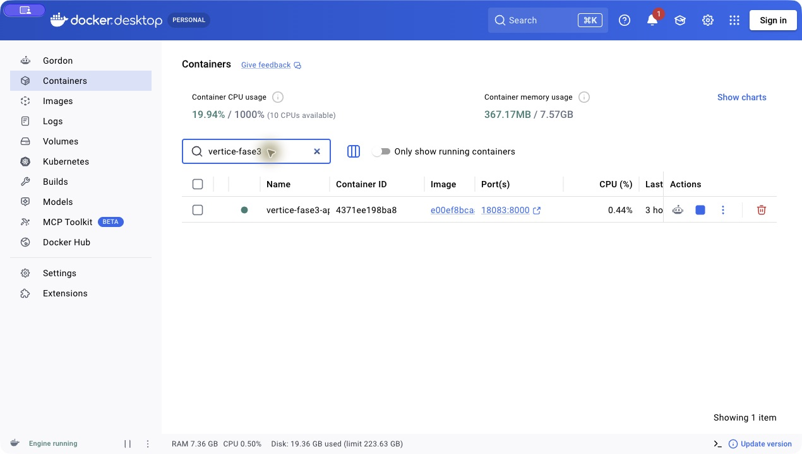

# Operación y validación del servicio de portafolios

Eduardo Aburto Angulo · Fase III

## Arquitectura y responsabilidades

La solución reúne API FastAPI, SVM calibrada, seguimiento MLflow, monitor por ventanas, reconciliador Docker y tablero Streamlit. El modelo clasifica noticias financieras en inglés; una probabilidad negativa igual o superior a 0.20 prioriza revisión humana. La salida no estima rendimientos ni indica el fondo que se debe comprar.
Como responsable del caso de negocio, revisaría la utilidad y pertinencia de cada señal. El responsable técnico custodia versiones y atiende incidentes; el responsable del modelo valida etiquetas y deriva; cumplimiento decide sobre privacidad, derechos de datos y alcance permitido. Es una propuesta de responsabilidades, no una designación de personal real.

## Contratos de observabilidad

Cada solicitud recibe un trace_id generado por el servicio. El log registra ruta normalizada, método, estado, duración y hash del modelo, sin guardar el texto enviado, nombres de clientes o credenciales. /v1/metrics exige autenticación y devuelve contadores y hasta 2 000 latencias recientes en memoria. Estos datos se reinician con el proceso; no sustituyen una plataforma durable de observabilidad.
Las trazas son identificadores de correlación locales; no implementé trazas distribuidas OpenTelemetry. La latencia del experimento se mide en el cliente con reloj monotónico, incluida la ida y vuelta HTTP. El contador de errores del servidor incluye estados 5xx; el monitor también incluye fallos de transporte. Los 4xx deben investigarse como errores de contrato y el ensayo exige respuestas 200.

## Indicadores y presupuesto de error

Definí disponibilidad de 99 % y 99 % de solicitudes con latencia no mayor de 250 ms, en ventanas de al menos 20 observaciones. Presupuesto permitido = N × 0.01. Consumo relativo = eventos malos / presupuesto permitido. Dos ventanas consecutivas incumplidas disparan la alerta P2 de latencia. Estos objetivos describen el laboratorio y no equivalen a un SLA mensual.
En las 80 solicitudes de las cuatro ventanas hubo 40 lentas por la inyección deliberada. El presupuesto de latencia era 0.8 solicitudes; el consumo relativo fue 50 veces y el saldo fue −39.2. La recuperación final no borra ese incumplimiento histórico. Todas las solicitudes de inferencia del ensayo respondieron 200; los sondeos de salud fallidos del candidato se conservan en la auditoría de despliegue y no se suman al denominador de inferencias.

## Runbooks y resultados

RB01, candidato no listo: detener la promoción, conservar la versión activa, restaurarla y verificar salud y hash. El ensayo inyectó FAIL_READINESS=1 y confirmó rollback_recovered=true. Si no existe versión saludable anterior, el reconciliador falla explícitamente y requiere intervención.
RB02, latencia persistente: confirmar dos ventanas incumplidas, registrar alerta P2, restaurar la configuración anterior y medir otra ventana. El p95 pasó de 5.45 ms en referencia a 426.24 y 426.46 ms con retardo; después del rollback fue 6.60 ms. Son mediciones locales de esta ejecución, no capacidad garantizada. Ante fallos persistentes mantendría el servicio fuera de uso y escalaría al responsable técnico.

## Calidad auditoría y optimización

La reevaluación preserva accuracy 0.9226, precision 0.6711, recall 0.8361, F1 0.7445 y ROC-AUC 0.9548. Los 10 falsos negativos representan noticias negativas omitidas; los 25 falsos positivos añaden trabajo de revisión. La cobertura lingüística y el cambio de dominio son límites materiales. El seguimiento de calidad futura requiere etiquetas independientes; una variación en entradas no prueba por sí sola degradación de desempeño.
La optimización implementada evita recrear contenedores cuando el estado ya coincide, limita recursos y reduce alertas por persistencia de dos ventanas. Los antecedentes de batching y fairness se conservan identificados como históricos, sin atribuirles una nueva medición. Priorizaría luego almacenamiento durable, métricas por cohortes, pruebas de carga sostenidas, firma de imágenes y un despliegue de dos instancias antes de afirmar preparación industrial.
## Métricas clave de desempeño y lectura operativa

Separo desempeño del clasificador, estado del servicio y utilidad de negocio. Mezclarlos llevaría a conclusiones incorrectas: una API rápida puede emitir una señal poco pertinente; un buen F1 histórico no prueba rentabilidad; una recuperación técnica no acredita continuidad mensual. Mi tablero muestra el origen y el alcance de la evidencia antes de interpretarla.

| Métrica del test congelado | Valor | Lectura para revisión humana |
|---|---:|---|
| Accuracy | 0.922566 | Proporción global correcta; puede ocultar el peso de la clase minoritaria |
| Precision | 0.671053 | De las señales negativas emitidas, una parte requiere descarte posterior |
| Recall | 0.836066 | Recupera 51 de 61 noticias negativas en este test |
| F1 | 0.744526 | Resume el equilibrio entre precision y recall al umbral fijado |
| ROC-AUC | 0.954761 | Discriminación entre clases en el test, no garantía de calibración ni utilidad financiera |
| Falsos negativos | 10 | Noticias negativas omitidas por la señal |
| Falsos positivos | 25 | Revisiones adicionales sobre noticias no negativas |

Fuente: `evidencias/evaluacion.json`. Clase positiva: noticia negativa. La matriz completa contiene 366 verdaderos negativos y 51 verdaderos positivos. Las métricas se calcularon sobre 452 noticias en inglés. El umbral 0.20 permanece congelado y no se seleccionó de nuevo en esta fase.

| Ventana local original | N | p95 HTTP ms | Disponibilidad | Cumplimiento de latencia |
|---|---:|---:|---:|---:|
| Referencia | 20 | 5.4497 | 100 % | 100 % |
| Retardo inyectado 1 | 20 | 426.2426 | 100 % | 0 % |
| Retardo inyectado 2 | 20 | 426.4559 | 100 % | 0 % |
| Recuperación | 20 | 6.5971 | 100 % | 100 % |

Fuente: `despliegue.json`. Estos porcentajes corresponden a solicitudes de inferencia del ensayo, no a todos los sondeos de salud ni a un mes de operación. Con sólo 20 observaciones por ventana, el percentil es una estadística descriptiva de esa muestra. No lo extrapolo a miles de clientes concurrentes ni reporto un intervalo de confianza inexistente.

## Presupuestos y decisiones de atención

El monitor compara la fracción de eventos buenos con 0.99 para disponibilidad y latencia. Exige al menos 20 observaciones. Para latencia, un evento malo supera 250 ms; para disponibilidad, se cuenta respuesta 5xx o fallo de transporte. La prueba además exige respuestas 200 para no aceptar silenciosamente errores 4xx del contrato. Estas definiciones delimitan qué mide cada indicador.

En cada ventana de 20 solicitudes se permiten 0.2 eventos malos como presupuesto proporcional. Las ventanas inducidas tuvieron 20 solicitudes lentas y consumieron cien veces ese presupuesto. En el conjunto de 80 solicitudes, el consumo fue cincuenta veces y el saldo negativo de 39.2. La alerta tras dos ventanas reduce sensibilidad a un pico aislado, a costa de esperar más antes de actuar. No medí una tasa real de falsas alertas; la reducción de ruido es una propiedad de diseño, no un ahorro cuantificado.

Una alerta P2 de latencia prioriza restaurar una configuración conocida. Si la restauración falla, el servicio requiere intervención. No existe una autorización implícita para modificar decisiones de inversión, reentrenar sin validación o cambiar el umbral con urgencia. La acción automatizada es reversible y se limita al laboratorio.

## Estrategias de auditoría y reconstrucción del incidente

`auditoria.jsonl` conserva eventos con tiempo Unix, acción, identificador de imagen y configuración. La secuencia permite distinguir `deploy_started`, `deploy_healthy`, `reconcile_noop` y `readiness_failed`. No interpreto un evento de inicio como evidencia de finalización: la confirmación de salud y el resultado de rollback son los que permiten cerrar el incidente técnico.

| Pregunta de auditoría | Evidencia que consulto | Qué no demuestra por sí sola |
|---|---|---|
| ¿Qué se quiso desplegar? | Candidato en `deploy_started` | Que haya llegado a estar sano |
| ¿Qué versión quedó activa? | `deploy_healthy` y estado guardado | Su idoneidad financiera |
| ¿Se evitó recreación innecesaria? | `reconcile_noop` | Un ahorro monetario medido |
| ¿Falló la promoción? | `readiness_failed` | La causa raíz completa sin diagnóstico |
| ¿Se restauró el servicio? | `rollback_recovered` y ventana posterior | Alta disponibilidad durante el reemplazo |
| ¿Qué solicitud produjo una señal? | `trace_id`, ruta, estado y hash en log JSON | Identidad del cliente, que no se registra |

La auditoría local es un archivo editable y no está firmada ni protegida contra alteraciones privilegiadas. Git conserva una versión publicada para revisión, pero eso no la convierte en un registro inmutable de producción. Propongo almacenamiento central con controles de acceso, retención definida y firma o protección equivalente antes de un piloto con datos reales. No presento esas medidas como implementadas.

## Acciones de optimización realizadas

| Acción implementada | Evidencia disponible | Consecuencia y límite |
|---|---|---|
| Reconciliación idempotente | Resultado `noop` en ambos ensayos | Evita recrear un contenedor sano sin cambios; no hay ahorro de costo medido |
| Comprobación de identidad y salud | Candidato no listo rechazado y rollback recuperado | Reduce promoción de una configuración defectuosa; no elimina interrupción |
| Restauración tras retardo persistente | p95 de 426.4559 a 6.5971 ms en ensayo original | Recupera la configuración estable; no mejora el algoritmo |
| Límites de recursos Docker | Declaración de dos CPU y 1 GB | Acota recursos permitidos; no es una medición de CPU o memoria usados |
| Persistencia de dos ventanas | Alerta tras dos incumplimientos | Evita reaccionar a una sola ventana; tasa de ruido no medida |
| Reevaluación de modelo congelado | Probabilidades idénticas al recargar MLflow | Evita introducir cambios predictivos en una entrega de operación |

No atribuyo a la Fase III los resultados históricos de batching de Actividad 9 como si los hubiera vuelto a medir. Tampoco afirmo que se implementaron caché, poda, cuantización o escalamiento horizontal. Incorporarlos sin experimento habría añadido complejidad sin evidencia de una necesidad en este laboratorio. Esa comparación es una decisión de alcance; no una prueba de inferioridad de otras soluciones.

## Runbooks y límites de recuperación

RB01 comienza cuando un candidato no responde sano. Se preserva el registro de la configuración anterior, se rechaza la promoción y se vuelve a iniciar esa configuración. Se comprueban autenticación, salud y hash. Si no existe versión anterior o no se recupera, el reconciliador falla y requiere intervención. No se cambia el modelo para resolver un incidente de infraestructura.

RB02 comienza con dos ventanas de latencia incumplida. Se confirma que las solicitudes usen el contrato previsto y se registra la alerta. Se restaura la configuración anterior y se mide una ventana posterior. El cierre del experimento está respaldado por sus aserciones y muestras, no sólo por el mensaje de éxito de un comando. La segunda ejecución confirmó recuperación nuevamente; sus cifras se conservan separadas en `despliegue_revision_final.json`.

Figura 1. Componentes del laboratorio y relación entre validación, servicio y auditoría. El gráfico no implica despliegue permanente ni trazas distribuidas.

Figura 2. Respuesta a retardo inyectado y recuperación. Se conserva la primera corrida como referencia del reporte; la repetición final tiene su propio archivo de evidencia.

## Monitoreo futuro y criterio de gobierno

Actividad 8 enseñó a distinguir detección, respuesta y recuperación; Actividad 9 añadió costos, escala y gobierno. Mantengo esas lecciones sin afirmar que el prototipo actual contiene una plataforma completa de observabilidad. Los contadores en memoria se reinician con el proceso. La correlación por trace_id es local; no existe Collector de OpenTelemetry. El tablero lee evidencias guardadas, no una cartera real en tiempo real.

Para un piloto propondría métricas por idioma y perfil, etiquetas independientes, análisis de deriva y retención durable. No usaría una señal de drift como autorización automática de reentrenamiento. El corpus CC BY-NC-SA 3.0 requiere resolver derechos para uso comercial y el modelo en inglés requiere adaptación validada al dominio mexicano. `production_authorized=false` se conserva. Los 150 clientes son personajes ficticios con posiciones de 5 a 20 millones MXN; el 1 % de compra y de venta son supuestos académicos. Una noticia inicia análisis, no autoriza una operación. La IA no sustituye el criterio del banquero; lo aumenta.

## Evidencia del proceso y fundamentos

La [bitácora](../evidencias/bitacora.md) reconstruye decisiones a partir de commits y configuración. El [registro de versiones](../evidencias/registro_versiones.md) documenta la cadena de procedencia y el umbral elegido con desarrollo en Actividad 6. No hubo reentrenamiento en Fase III. Actividad 8 aporta el antecedente de observabilidad y Actividad 9 el de escalabilidad, FinOps y gobierno. La meta conjunta histórica de recall ≥90 % y precisión ≥60 % no se alcanzó; no la presento como cumplida.

Las decisiones de SLO y presupuesto se relacionan con Beyer et al. (2018); el seguimiento de artefactos con MLflow (s. f.); los contratos de servicio con Ramírez (s. f.); la portabilidad y automatización con Docker (s. f.) y GitHub (s. f.); y la evaluación con Scikit-learn developers (s. f.). Malo et al. (2014) documentan el problema de orientación semántica financiera del corpus. NIST (2023) e ISO/IEC 42001:2023 aportan referentes de gestión responsable; citarlos no equivale a certificar cumplimiento ni a acreditar una auditoría normativa integral. La rúbrica de Universidad Tecmilenio (2026) determina los cuatro entregables.

## Evidencia visual del desarrollo

Figura 3. Corrida 45924738199 de GitHub Actions con validación y despliegue aprobados. La captura documenta la ejecución original; las correcciones editoriales tienen sus propias corridas y solicitudes de cambio. Los avisos de mantenimiento de Actions se conservan visibles y no se interpretan como pruebas fallidas.

Figura 4. Docker Desktop muestra el contenedor vertice-fase3 en ejecución durante la revisión. Esta captura confirma el estado observado; los valores de consumo de la interfaz no son una prueba de carga ni se utilizan como benchmark. Los resultados del experimento se consultan en despliegue.json y auditoria.jsonl.

## Conclusiones

Concluyo que la respuesta a un incidente debe preservar evidencia, recuperar una configuración conocida y reconocer el presupuesto consumido. En mi práctica bancaria, una recuperación rápida no elimina la obligación de explicar lo ocurrido. Mantengo el ánimo de fortalecer observabilidad durable y validación prospectiva, pero no afirmo que estén implementadas. La medición local confirma recuperación dentro del alcance probado, no disponibilidad mensual ni alta disponibilidad. La IA no sustituye el criterio del banquero; lo aumenta.

## Referencias

Beyer, B., Murphy, N. R., Rensin, D. K., Kawahara, K., & Thorne, S. (Eds.). (2018). *The site reliability workbook: Practical ways to implement SRE*. O’Reilly Media. https://sre.google/workbook/table-of-contents/

Docker, Inc. (s. f.). *Docker documentation*. Recuperado el 27 de noviembre de 2026, de https://docs.docker.com/

GitHub. (s. f.). *GitHub Actions documentation*. Recuperado el 27 de noviembre de 2026, de https://docs.github.com/en/actions

International Organization for Standardization, & International Electrotechnical Commission. (2023). *Information technology—Artificial intelligence—Management system* (ISO/IEC Standard No. 42001:2023). https://www.iso.org/standard/42001

Malo, P., Sinha, A., Korhonen, P., Wallenius, J., & Takala, P. (2014). Good debt or bad debt: Detecting semantic orientations in economic texts. *Journal of the Association for Information Science and Technology, 65*(4), 782–796. https://doi.org/10.1002/asi.23062

MLflow. (s. f.). *MLflow tracking*. Recuperado el 27 de noviembre de 2026, de https://mlflow.org/docs/latest/ml/tracking/

National Institute of Standards and Technology. (2023). *Artificial intelligence risk management framework (AI RMF 1.0)* (NIST AI 100-1). https://doi.org/10.6028/NIST.AI.100-1

Ramírez, S. (s. f.). *FastAPI*. Recuperado el 27 de noviembre de 2026, de https://fastapi.tiangolo.com/

Scikit-learn developers. (s. f.). *Scikit-learn user guide*. Recuperado el 27 de noviembre de 2026, de https://scikit-learn.org/stable/user_guide.html

Universidad Tecmilenio. (2026). *Gestión de proyectos de inteligencia artificial: Proyecto Fase III Resultados y rúbrica de evaluación* [Material del curso, Módulo 3, Semana 12].

## Cobertura de la rúbrica

| Apartado | Cómo lo cubre esta entrega | Evidencia complementaria |
|---|---|---|
| Pipeline automatizado de IA | Validación de código y datos, versionado y CD temporal | 01_Pipeline.pdf, workflow y corridas Actions |
| Operación técnica | Métricas, auditoría, incidentes y optimización delimitada | 02_Operacion.pdf y archivos de evidencia |
| Portfolio técnico estratégico | Valor esperado, stack, trayectoria y resultados | 03_Portfolio.pdf y business case de Fase I |
| Entrevista profesional | Guion, MP4 existente y material de grabación personal | Video sintético identificado; grabación propia pendiente |

Este documento fue estructurado precisamente para cubrir esos 4 apartados de forma explícita y verificable.
