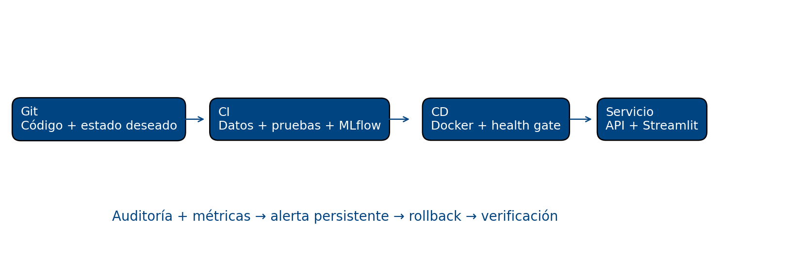
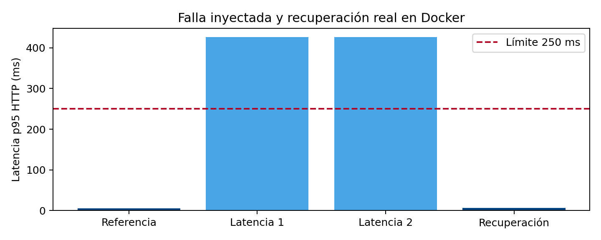
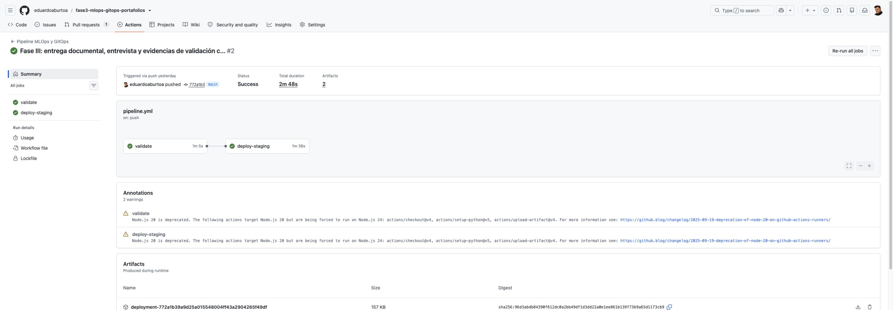
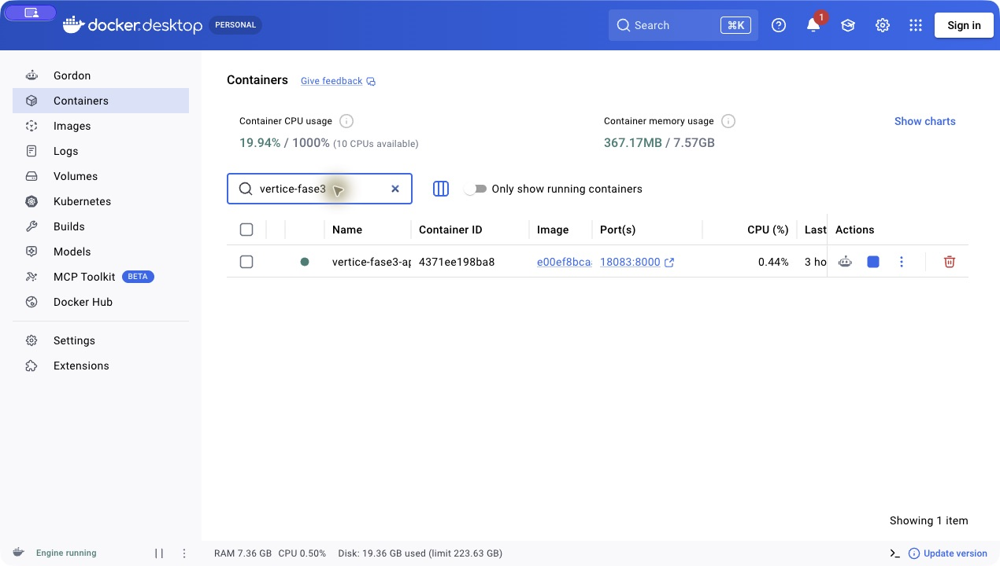

# Portfolio técnico estratégico de Vértice AI

Eduardo Aburto Angulo · Fase III

Como banquero Patrimonial Sr. con 20 años en banca, sostengo el proyecto en una condición: el cliente conserva $1.04 por cada peso de corretaje en la proyección de Fase I. El caso plantea 3,600 clientes, ROI a tres años de 298.6 % e inversión piloto de $9,083,448 MXN. Estas cifras son expectativas del business case, no beneficios realizados por el prototipo. La IA no sustituye el criterio del banquero; lo aumenta.

## Problema y propuesta de valor

Como banquero Sr., quiero llegar a la revisión de portafolio con señales claras, fuentes identificables y argumentos que pueda explicar al cliente. La solución organiza una señal de noticias negativas para priorizar revisión humana. El valor potencial es reducir el tiempo de preparación y hacer más consistente el seguimiento; todavía no medí ahorro operativo ni rentabilidad incremental en clientes reales.
El caso conserva 150 clientes ficticios con nombres de superhéroes y villanos y posiciones de 5 a 20 millones de pesos. Esta elección permite dar personalidad a los escenarios sin utilizar datos confidenciales. El contexto es didáctico y no representa una cartera real ni una implementación oficial de BBVA.

## Trayectoria y decisiones

Actividad 4 exploró modelos preentrenados; Actividad 5 desarrolló entrenamiento trazable; Actividad 6 evaluó umbrales y generalización. Fase II integró API y contenedores. Actividad 8 agregó observabilidad e incidentes y Actividad 9 revisó costos y gobernanza. En Fase III integré un flujo de validación y despliegue continuo académico con evidencia reproducible.
La decisión principal fue conservar el modelo y el umbral mientras construía la operación. Así evité mezclar mejora del algoritmo con cambios de infraestructura. El test histórico sirve para verificar regresiones, no para escoger nuevas configuraciones. Elegí FastAPI por sus contratos, Docker por portabilidad, MLflow por trazabilidad y Streamlit por acceso sencillo a resultados.

## Resultados y alcance demostrado

El modelo congelado obtuvo F1 0.7445 y ROC-AUC 0.9548 en 452 registros; la recarga desde MLflow reprodujo exactamente sus probabilidades. Nueve pruebas locales aprobaron los contratos implementados. El contenedor recuperó su operación después de un candidato no listo y de una latencia inducida. La última ventana quedó debajo del límite de 250 ms.
Estas evidencias muestran que el prototipo puede probarse, desplegarse y recuperarse en laboratorio. No prueban rentabilidad, idoneidad regulatoria, disponibilidad mensual ni escalabilidad ante demanda real. Presento también los límites porque una decisión profesional necesita distinguir lo medido de lo esperado.

## Economía y gobierno responsable

El escenario comercial calcula beneficio incremental supuesto, costos adicionales y corretaje de 1 % por compra más 1 % por venta sobre el nocional migrado. Esa comisión es un supuesto académico, no una tarifa corroborada de BBVA. Los gastos deben incluirse sólo si no están ya descontados de la rentabilidad para evitar doble conteo. No equiparo ingreso bruto por comisiones con utilidad neta del banco.
Una revisión sólo se considera elegible si conserva el perfil y el beneficio neto supuesto es positivo. El incentivo comercial no debe justificar rotación innecesaria. Antes de uso real exigiría consentimiento, revisión de idoneidad, verificación de cada ficha y serie, derechos de uso de datos, supervisión humana y seguimiento del resultado neto del cliente. La autorización de producción permanece desactivada.

## Presentación profesional y siguientes pasos

La entrevista adjunta expone el problema, la arquitectura, la evidencia de recuperación, los límites del modelo y los criterios de gobierno. Es una dramatización con voces sintéticas y guion en primera persona, no una grabación de mi voz ni una entrevista real. El guion permite preparar una defensa personal y responder preguntas técnicas o de gestión.
Mi siguiente hito sería una evaluación prospectiva en sombra: señales sin operaciones, etiquetado independiente, métricas por perfil e idioma y medición de tiempo de preparación frente a una línea base. Sólo después decidiría si existe beneficio suficiente para ampliar el piloto. El objetivo de esta fase es demostrar disciplina de entrega y capacidad de comunicar las decisiones con evidencia.
## Valor de negocio y condición de viabilidad

Mi business case de Fase I parte de una condición concreta: **por cada peso de corretaje que paga, el cliente conserva $1.04**. Esa relación es una proyección del caso, no un resultado observado en la Fase III. Si dejara de ser positiva, tendría que revisar la viabilidad del proyecto antes de promoverlo. La arquitectura sólo tiene sentido si permite preparar mejores revisiones y proteger el interés del cliente.

| Supuesto o proyección de Fase I | Cifra conservada | Lectura para la decisión |
|---|---:|---|
| Escala objetivo | 24 asesores × 150 clientes = 3,600 clientes | Tamaño proyectado, distinto de los 150 personajes del laboratorio |
| AUM simulado | $54,397 millones MXN | Patrimonio del escenario, no activos reales administrados por el prototipo |
| Revisiones anuales | 7,200 | Volumen previsto del proceso de revisión |
| Piloto de meses 1 a 9 con seis asesores | $9,083,448 MXN | Inversión prevista; no gasto ejecutado en esta fase |
| Operación anual | $4,769,996 MXN | Presupuesto del proyecto completo, no sólo infraestructura NLP |
| Beneficio esperado anual a pleno funcionamiento | $40,540,443 MXN | Beneficio esperado, no ingreso realizado ni atribuible a esta evaluación |
| ROI a tres años | 298.6 % | Escenario base de Fase I |
| Recuperación base | Mes 13 | Punto de recuperación proyectado |
| ROI conservador y recuperación | 38.8 % y mes 25 | Escenario conservador; no intervalo estadístico |
| Relación cliente y corretaje | $1.04 por cada peso | Condición central de valor esperado para el cliente |
| Umbral de rotación | 3.0 puntos porcentuales por encima del 2 % de costo | Regla del business case; no es el umbral NLP 0.20 |

Fuente: `evidencias/antecedentes/negocio_fase1.json`, campo `source_inputs`, y cifras reafirmadas por Eduardo en esta revisión. Las copio sin recalcular. No combino el ROI con resultados de clasificación para fabricar un beneficio observado. Tampoco equiparo 7,200 revisiones anuales con llamadas de inferencia: una revisión puede utilizar varias señales y requiere intervención humana.

En Fase III generé valor técnico verificable: un flujo repetible, decisiones de despliegue auditables y recuperación de fallas controladas. Su traducción a valor económico sigue siendo una hipótesis del piloto. Esa distinción permite presentar avances sin convertir expectativas comerciales en logros financieros.

## Stack tecnológico y alternativas de diseño

La tabla describe la solución implementada y mi evaluación actual de alternativas. No implica que haya ejecutado pruebas comparativas de todos los productos descartados. Las decisiones de integración y operación se apoyan en el código y las ejecuciones; la comparación de alternativas es razonamiento técnico documentado.

| Capa | Tecnología | Por qué la elegí | Alternativa no incorporada y razón |
|---|---|---|---|
| Lenguaje | Python 3.12 | Continuidad con entrenamiento, evaluación y scripts del proyecto | Reescritura en otro lenguaje: añadiría trabajo sin evidencia de beneficio |
| Modelo | scikit-learn 1.6.1 | Permite recargar la SVM calibrada y comparar probabilidades | Reentrenar otro algoritmo: cambiaría la pregunta de esta fase y exigiría nueva validación |
| Servicio | FastAPI | Contratos de entrada, validación y separación de API | Inferencia sólo dentro de la interfaz: dificultaría probar un contrato independiente |
| Contenedor | Docker | Empaqueta dependencias y permite reproducir despliegues | Ejecución manual sin contenedor: menor consistencia entre equipos |
| Automatización | GitHub Actions | Evidencia vinculada al commit, pruebas y trabajos dependientes | Despliegue manual: menos trazabilidad de qué validación precedió a la promoción |
| Seguimiento | MLflow 2.22.2 | Parámetros, métricas y modelo como artefacto de cada corrida | Sólo un CSV: perdería el vínculo con el artefacto recargable |
| Interfaz | Streamlit | Navegación sencilla por resultados y evidencia existente | Frontend a medida: no era necesario para demostrar los criterios de esta fase |
| Estado deseado | JSON y reconciliador Python | Configuración versionada, salud e idempotencia observables | Kubernetes/Argo CD: mayor complejidad para un único contenedor académico; no comparé costos reales |

El stack no convierte por sí mismo al proyecto en un sistema industrial. Docker no acredita seguridad integral; MLflow no garantiza calidad de etiquetas; GitHub Actions no constituye una aprobación de negocio. La integración hace visibles los controles y facilita repetirlos. Para el banquero, esto significa poder solicitar evidencia de versión y alcance antes de confiar en una señal.

## Trayectoria completa del proyecto

| Entrega | Aporte al cierre | Evidencia o repositorio |
|---|---|---|
| Fase I | Business case, escala, inversión, ROI y escenarios | [Cifras preservadas](../evidencias/antecedentes/negocio_fase1.json) |
| Actividad 4 | Comparación de modelos preentrenados para el caso | [motor-senales-nlp](https://github.com/eduardoaburtoa/motor-senales-nlp) |
| Actividad 5 | Preparación, entrenamiento y trazabilidad en MLflow | [actividad5](https://github.com/eduardoaburtoa/actividad5-mlflow-portafolios) |
| Actividad 6 | Métricas, validación y evaluación del umbral | [actividad6](https://github.com/eduardoaburtoa/actividad6-evaluacion-portafolios) |
| Fase II | Contenerización e integración por API | [fase2](https://github.com/eduardoaburtoa/fase2-despliegue-portafolios) |
| Actividad 8 | Observabilidad, SLO y respuesta a incidentes | [actividad8](https://github.com/eduardoaburtoa/actividad8-observabilidad-portafolios) |
| Actividad 9 | Escalabilidad, FinOps y gobernanza | [actividad9](https://github.com/eduardoaburtoa/actividad9-escalabilidad-gobernanza) |
| Fase III | Validación y despliegue automatizados con recuperación comprobada | [Fase III](https://github.com/eduardoaburtoa/fase3-mlops-gitops-portafolios) |

Conservo la continuidad sin atribuir a cada fase capacidades que todavía no desarrollé. Actividad 8 aporta antecedentes operativos; Actividad 9 aporta análisis de escala y gobierno. Fase III integra un laboratorio reproducible y un relato de decisiones. El historial de commits y el hash del modelo permiten verificar esa continuidad con más precisión que una lista de herramientas.

## Próximo hito de negocio

Mi siguiente paso es el piloto de nueve meses con seis asesores previsto en Fase I. Antes de autorizarlo, necesito resolver la licencia CC BY-NC-SA 3.0 del corpus, validar el idioma y dominio mexicanos, y definir un protocolo de evaluación prospectiva. La estimación de $9,083,448 MXN no constituye autorización de gasto ni prueba de suficiencia presupuestaria actual.

Propongo medir tiempo de preparación de una revisión, utilidad de las señales, proporción de alertas descartadas por el banquero y costo operativo. La línea base, la selección de casos y el criterio de éxito deben acordarse antes de observar resultados. La primera ejecución sería en sombra, con revisión humana y sin movimientos automáticos. El beneficio neto del cliente debe medirse después de comisiones y costos, preservando su perfil.

La Fase III acredita que la arquitectura funciona en el alcance probado. No acredita que se materialicen el beneficio esperado de $40,540,443 MXN ni el ROI de 298.6 %. Mi decisión de avanzar dependería de evidencia nueva del piloto; mantener esta separación protege tanto la credibilidad del proyecto como la confianza del cliente.

## Evidencia del proceso y fundamentos

La [bitácora](../evidencias/bitacora.md) reconstruye decisiones a partir de commits y configuración. El [registro de versiones](../evidencias/registro_versiones.md) documenta la cadena de procedencia y el umbral elegido con desarrollo en Actividad 6. No hubo reentrenamiento en Fase III. Actividad 8 aporta el antecedente de observabilidad y Actividad 9 el de escalabilidad, FinOps y gobierno. La meta conjunta histórica de recall ≥90 % y precisión ≥60 % no se alcanzó; no la presento como cumplida.

Las decisiones de SLO y presupuesto se relacionan con Beyer et al. (2018); el seguimiento de artefactos con MLflow (s. f.); los contratos de servicio con Ramírez (s. f.); la portabilidad y automatización con Docker (s. f.) y GitHub (s. f.); y la evaluación con Scikit-learn developers (s. f.). Malo et al. (2014) documentan el problema de orientación semántica financiera del corpus. NIST (2023) e ISO/IEC 42001:2023 aportan referentes de gestión responsable; citarlos no equivale a certificar cumplimiento ni a acreditar una auditoría normativa integral. La rúbrica de Universidad Tecmilenio (2026) determina los cuatro entregables.

Figura 1. Stack y flujo técnico del laboratorio.

Figura 2. Recuperación de latencia medida; no representa un beneficio financiero realizado.

## Evidencia visual del desarrollo

Figura 3. Corrida 45924738199 de GitHub Actions con validación y despliegue aprobados. La captura documenta la ejecución original; las correcciones editoriales tienen sus propias corridas y solicitudes de cambio. Los avisos de mantenimiento de Actions se conservan visibles y no se interpretan como pruebas fallidas.

Figura 4. Docker Desktop muestra el contenedor vertice-fase3 en ejecución durante la revisión. Esta captura confirma el estado observado; los valores de consumo de la interfaz no son una prueba de carga ni se utilizan como benchmark. Los resultados del experimento se consultan en despliegue.json y auditoria.jsonl.

## Conclusiones

Concluyo que el valor técnico generado es una entrega trazable que puedo explicar y reproducir. El valor económico de Fase I sigue siendo esperado y debe contrastarse en el piloto. Con veinte años en banca, sostengo que la confianza del cliente depende de esa claridad. Mantengo el ánimo de avanzar con seis asesores durante nueve meses, sujeto a validación y autorizaciones; no confundo arquitectura funcional con ROI materializado. La IA no sustituye el criterio del banquero; lo aumenta.

## Referencias

Beyer, B., Murphy, N. R., Rensin, D. K., Kawahara, K., & Thorne, S. (Eds.). (2018). *The site reliability workbook: Practical ways to implement SRE*. O’Reilly Media. https://sre.google/workbook/table-of-contents/

Docker, Inc. (s. f.). *Docker documentation*. Recuperado el 27 de noviembre de 2026, de https://docs.docker.com/

GitHub. (s. f.). *GitHub Actions documentation*. Recuperado el 27 de noviembre de 2026, de https://docs.github.com/en/actions

International Organization for Standardization, & International Electrotechnical Commission. (2023). *Information technology—Artificial intelligence—Management system* (ISO/IEC Standard No. 42001:2023). https://www.iso.org/standard/42001

Malo, P., Sinha, A., Korhonen, P., Wallenius, J., & Takala, P. (2014). Good debt or bad debt: Detecting semantic orientations in economic texts. *Journal of the Association for Information Science and Technology, 65*(4), 782–796. https://doi.org/10.1002/asi.23062

MLflow. (s. f.). *MLflow tracking*. Recuperado el 27 de noviembre de 2026, de https://mlflow.org/docs/latest/ml/tracking/

National Institute of Standards and Technology. (2023). *Artificial intelligence risk management framework (AI RMF 1.0)* (NIST AI 100-1). https://doi.org/10.6028/NIST.AI.100-1

Ramírez, S. (s. f.). *FastAPI*. Recuperado el 27 de noviembre de 2026, de https://fastapi.tiangolo.com/

Scikit-learn developers. (s. f.). *Scikit-learn user guide*. Recuperado el 27 de noviembre de 2026, de https://scikit-learn.org/stable/user_guide.html

Universidad Tecmilenio. (2026). *Gestión de proyectos de inteligencia artificial: Proyecto Fase III Resultados y rúbrica de evaluación* [Material del curso, Módulo 3, Semana 12].

## Cobertura de la rúbrica

| Apartado | Cómo lo cubre esta entrega | Evidencia complementaria |
|---|---|---|
| Pipeline automatizado de IA | Validación de código y datos, versionado y CD temporal | 01_Pipeline.pdf, workflow y corridas Actions |
| Operación técnica | Métricas, auditoría, incidentes y optimización delimitada | 02_Operacion.pdf y archivos de evidencia |
| Portfolio técnico estratégico | Valor esperado, stack, trayectoria y resultados | 03_Portfolio.pdf y business case de Fase I |
| Entrevista profesional | Guion, MP4 existente y material de grabación personal | Video sintético identificado; grabación propia pendiente |

Este documento fue estructurado precisamente para cubrir esos 4 apartados de forma explícita y verificable.
